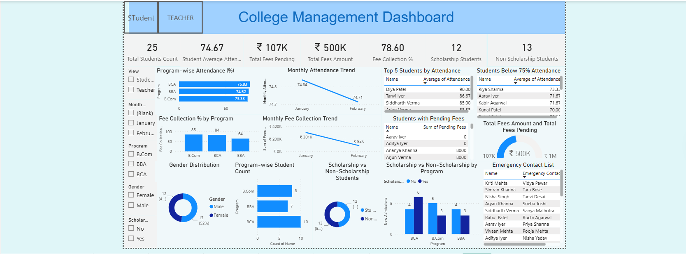
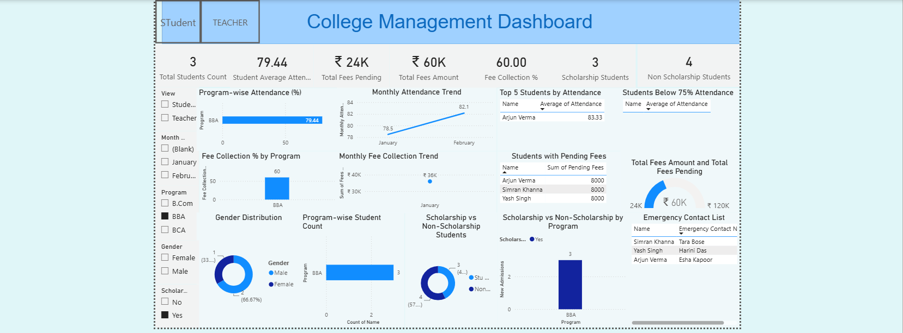
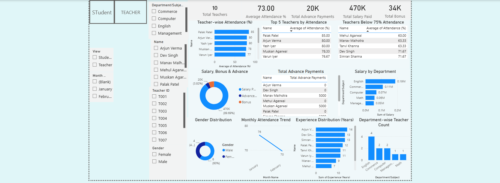
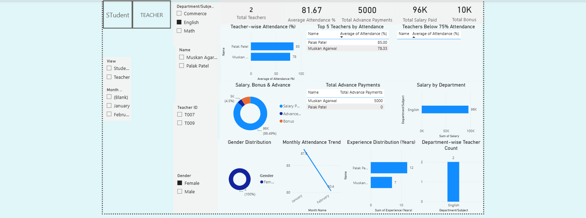

# College Management & Analytics Dashboard

A Power BI dashboard that brings a college's student and faculty data together into one place, so administrators aren't digging through five different spreadsheets to answer a simple question.

## About the Project

This was an internship project: build an analytics dashboard for a college, covering both students and teachers. The idea was to take raw records — attendance sheets, fee logs, payroll data — and turn them into something an administrator could actually open and use, rather than a pile of numbers someone has to manually cross-reference every time.

A quick note on the data: it's synthetic. No real students or teachers are in here — every name, email, and phone number was generated for this project.

## The Problem

Most colleges end up tracking attendance, fees, and payroll in separate spreadsheets that don't talk to each other. That makes it genuinely hard to answer questions that should be easy — which students are falling behind on attendance or fees, how one programme is doing compared to another, or whether teachers who've been missing classes are still getting full bonuses. This dashboard was built to put all of that in one view.

## What I Did

- Cleaned up the raw data — fixed inconsistent values, checked data types, and made sure the numbers actually added up (paid plus pending equalling total fees, monthly payments summing to what each student had actually paid).
- Designed a proper relational structure across five linked tables: students, teachers, daily attendance for each, and monthly fee payments.
- Built and tested a MySQL version of this same structure, with keys, data types, and validation queries, as a separate exercise. It's not wired up to the live dashboard yet, but the groundwork's done for when I take this further.
- Built the dashboard itself in Power BI — DAX measures for the KPIs, two tabs for Student and Teacher data, and slicers for programme, department, gender, scholarship status, and month.
- Went back through the first working version and fixed what wasn't quite right: averages that were accidentally showing as sums, totals rows that didn't mean anything, raw tables that should've been charts, a gauge visual that was completely broken, and a layout that needed to be grouped more sensibly.

## Dataset

Everything sits across five linked, synthetic tables:

- **Students** (25 records) — ID, name, programme, section, gender, date of birth, address, fees paid/pending/total, attendance %, enrolment date, previous school, scholarship status, emergency contact.
- **Student attendance** (1,500 daily records) — student ID, date, present/absent.
- **Fee payments** (35 monthly records) — student ID, month, amount paid.
- **Teachers** (10 records) — ID, name, department, qualification, experience, attendance %, salary, bonus, advance payment, joining date.
- **Teacher attendance** (600 daily records) — teacher ID, date, present/absent.

The college runs three programmes — BCA, B.Com, and BBA — and teachers are spread across five departments: Computer (which covers BCA), Commerce (B.Com), Management (BBA), and English and Math, which are taught across all three programmes.

## Student Tab

This tab is where you'd look if you wanted to know how students are doing, academically and financially. The top row gives you the headline numbers at a glance:

- 25 students total
- 74.67% average attendance
- ₹5L in total fees, with ₹1.07L still pending
- A 78.60% collection rate
- A 12-to-13 split between students on scholarship and those without

Below that:

- Attendance by programme — BCA at 75.83%, BBA at 74.52%, B.Com at 73.33%
- Fee collection by programme — B.Com and BCA collecting well at 85% and 84%, while BBA lags behind at 64%
- A monthly attendance trend
- A list of students who've dropped below the 75% attendance mark
- A list of students with fees still pending
- Gender and scholarship distribution, including how scholarships split across programmes

Everything on this tab can be filtered by programme, gender, scholarship status, and month.

### Filtering it down

Here's the same tab filtered down to BBA students on a scholarship — every card and chart recalculates instantly, down to the one student who matches. That's really the point of a dashboard like this: an administrator can go from "the whole college" to "just this one slice" in a couple of clicks, without anyone writing a new query or pulling a new report.

## Teacher Tab

This tab mirrors the same idea but for faculty — attendance, payroll, and how things look department by department. The top cards show:

- 10 teachers
- 73.00% average attendance
- ₹470K in total salary paid
- ₹34K in bonuses
- ₹20K in advance payments

Underneath:

- Teacher-wise attendance
- A monthly trend, which drops noticeably from 76.1% in January to 69.6% in February
- A top-5 list by attendance, and a list of teachers who've fallen below the 75% mark
- Department-wise teacher count and salary
- A breakdown of salary versus bonus versus advances
- Gender distribution and how experience is spread across the team

This tab filters by department, gender, and month.

### Filtering it down

Filtering this down to the English department and female teachers narrows it to one person — Muskan Agarwal — with her attendance, salary, bonus, and advance payments all recalculating live. Same behaviour as the Student tab, just applied to the faculty side.

## Key Insights

A few things stood out once the data was actually laid out:

- Average student attendance is 74.67%, and 12 of the 25 students are below the 75% threshold.
- Fee collection is sitting at 78.6%, with ₹1.07 lakh still pending out of ₹5 lakh total — and BBA is the weak point, collecting only around 64%.
- Scholarships are almost evenly split: 12 students have one, 13 don't.
- Teacher attendance averages 73.0% but dropped sharply from 76.1% in January to 69.6% in February.
- Five of the ten teachers are below 75% attendance, and they still received ₹11,000 of the ₹34,000 total bonus paid out — worth a closer look if bonuses are meant to reward attendance.

## Tech Stack

- **Power BI** for the data model, DAX measures, and the dashboard itself
- **Excel** for the source data and initial cleaning
- **MySQL** — a schema was designed and tested separately as groundwork for a future database-backed version

## Limitations

- The dataset is small and only covers a few months.
- Daily attendance records include every calendar day, Sundays included.
- The dashboard is read-only — there's no way to enter new data directly through it yet.

## Future Scope

- Connecting the dashboard directly to the MySQL database instead of Excel
- A Flask backend with a simple web front end for actual data entry
- Adding exam results and subject-wise attendance
- A model to flag at-risk students based on attendance and fee patterns
